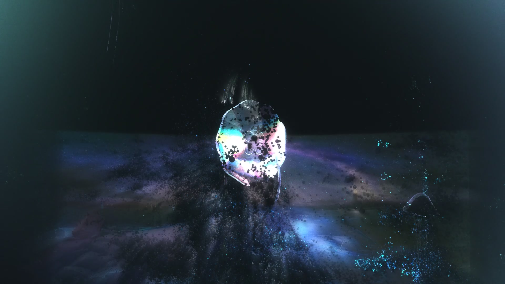
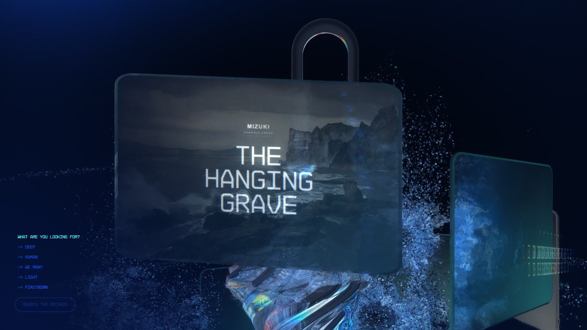

# 【个人向水月与深蓝之树艺术展示页】名为水月的生灵再也无法返回大地。

个人向《明日方舟：水月与深蓝之树》艺术展示页。

以水母片、收拢雨伞、十四张CG、深蓝根系与六边形鳞片串联一段可滚动、可交互、可随《海愿》自动播放的实时WebGL演出。

**项目参考了 [Snychng/open-active-theory](https://github.com/Snychng/open-active-theory?utm_source=chatgpt.com)。** 在其工程基础上进行主题、模型、CG、文案、配色与演出时间轴改造；Hydra / GLUI / Proton / FBR及相关运行资源继续保留原始来源说明。感谢参考项目与原视觉实现。





## 体验

- 滚轮浏览，拖动水母片，点击CG进入详情。
- **空格**：从最顶部开始随歌曲自动演出；再次按空格暂停或继续。
- **Shift + 空格**：重新开始；**Esc**：退出自动演出。
- 输入框内打字时，空格保持原有输入行为。

自动演出以歌曲的实际播放时间驱动滚动、光流和CG详情：24秒进入雨伞与CG，65秒进入Precious Days，80秒进入Price of Peace，113秒进入鳞片CG。结尾光流在歌曲结束时收束。

## 本地运行

需要Node.js 20或更新版本，以及启用硬件加速、支持WebGL的浏览器。

```bash
git clone https://github.com/Buster-Long/mizuki-caerula-arbor-art.git
cd mizuki-caerula-arbor-art
npm ci
npm run build
npm start
```

打开 http://localhost:4199/ 。PowerShell更换端口：

```powershell
$env:PORT='63063'
npm start
```

源码、构建基线和运行资源包含在项目中，无需API密钥或在线CMS账号。完整体验使用Node服务；仅托管public目录不能提供本地检索与WebSocket同步。修改源文件后运行`npm run build`再刷新网页。

## 实现与维护

### 云端部署

仓库包含`render.yaml`，配置为Render新加坡区域的免费Node服务，使用已构建的`public/`资源，只安装运行依赖，并保留CG深链接、作品查询和WebSocket服务。可在Render中创建Blueprint并导入本仓库；确认实例方案为`Free`后再部署。免费实例闲置15分钟会休眠，再次访问约需一分钟唤醒；流量仍受平台免费额度限制。默认提供HTTPS子域名，国内网络的实际可达性须在上线后验证，不能将部署成功等同于全国各运营商均可访问。

只更新源文件时，先在本地运行`npm run build`，再将相应`public/`生成物一起提交；此配置在云端直接运行仓库中已构建的版本。

| 入口 | 内容 |
| --- | --- |
| `src/content.mjs` | 十四条CG记录、正文与项目链接 |
| `src/show-controller.js` | 音乐时钟、自动滚动与CG详情时间轴 |
| `scripts/umbrella.mjs` | 雨伞几何、伞柄、接头、骨架与挂饰 |
| `scripts/deep-blue-roots.mjs` | 深蓝根系几何 |
| `scripts/blue-palette.mjs` | 局部蓝色氛围与彩虹反光材质适配 |
| `scripts/scene-background.mjs` | 首幕和尾幕背景实例隔离 |
| `scripts/show-adapter.mjs` | 自动演出期间驱动原生粒子光流 |
| `scripts/build.mjs` | 从src与vendor基线生成public |

浏览器渲染使用原生Hydra / WebGL / GLSL / GLUI / Proton；Three.js仅参与离线几何构建。没有用普通Three.js重写原场景，也没有用视频替代实时网页。技术取舍记录在`.agents/notes/`。

检查命令：`npm run check`（需先启动服务）；完整检查为`npm test`。本机使用已安装的Chrome时，PowerShell先设置`$env:PLAYWRIGHT_CHANNEL='chrome'`。自动演出以实际录制和关键时点检查为依据，历史全站检查不代替当前版本的真实设备或视觉验收。

## 来源与边界

- 参考工程：[Snychng/open-active-theory](https://github.com/Snychng/open-active-theory)。
- 原运行时与视觉资源来源：[Active Theory](https://activetheory.net/)，发布版本`1780406240914`；保存基线与凭证移除记录见`vendor/activetheory/SOURCE.json`。
- 角色、CG、音乐等《明日方舟》相关素材的权利归原权利方，本项目为个人向非官方展示，不代表官方作品。
- 雨伞与根系是根据参考重建的几何，不是官方游戏模型提取。
- 完整来源与许可说明见[THIRD_PARTY_NOTICES.md](THIRD_PARTY_NOTICES.md)。本项目不为第三方运行时、美术或音乐追加统一MIT等开源许可。
- 原基线的`lab.gif`与`damaged_road_normal.jpg`仍属已知缺失项，由原渲染器回退。画面与性能随GPU、视口和随机粒子存在差异。
